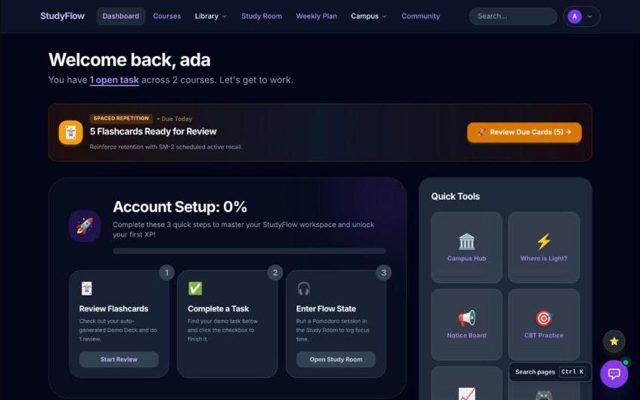
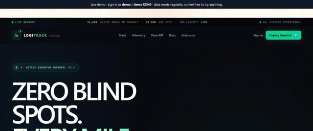
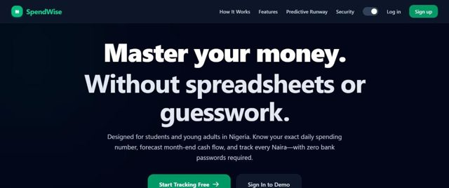

# Afolabi Peter

I'm a full-stack developer in Minna, Nigeria, and a Computer Engineering student at FUT Minna (CGPA 3.79/5). I like the unglamorous parts that make an app safe to depend on: checking payments on the server, letting the database refuse bad data, and writing tests that prove the numbers add up.

**Portfolio:** [Portfolio site](https://portfolio-one-kappa-p2gg1ejjj4.vercel.app) · **CV:** [Download PDF](https://portfolio-one-kappa-p2gg1ejjj4.vercel.app/Afolabi-Peter-CV.pdf) · **Email:** afolabiprosper329@gmail.com · **LinkedIn:** [Afolabi Peter](https://www.linkedin.com/in/afolabipeter-dev)

**Open to** junior full-stack, frontend or backend roles (remote or in Nigeria) and freelance builds for small businesses.

### Things I've built

| | What it is | The part I'm proud of |
|---|---|---|
| **[Oja Ledger](https://github.com/peterafolabi-dev/oja-ledger)** · [live](https://oja-ledger.vercel.app) | Bookkeeping app for market traders that works with no internet | Every entry is sealed with a SHA-256 fingerprint of the one before it, money is whole kobo (never floats), and four ledger invariants are checked against 200 generated trading histories on every push |
| **[Travel & Stays](https://github.com/peterafolabi-dev/travel-stays)** · [live](https://travel-stays.vercel.app) | Booking site for stays and tours across Nigeria, built at my MALhub internship | The database itself refuses two bookings for the same dates, and a booking only counts as paid after the server checks the exact amount with Paystack |
| **[RedCart](https://github.com/peterafolabi-dev/Retail-Logistics-Core)** · [live](https://redcart-ten.vercel.app) | Online store with Paystack checkout and an AI shopping assistant | The assistant answers from real store data and policies instead of guessing; 98 tests in CI |
| **[StudyFlow](https://github.com/peterafolabi-dev/studyflow)** · [live](https://studyflow-xt1x.onrender.com) | Study app for FUT Minna students: AI coach that knows your deadlines, CGPA tracker, 75% attendance tracker | The coach is trained with a teaching playbook and must pass a 13-scenario exam against the live model; 168 tests in CI |
| **[LogiTrack](https://github.com/peterafolabi-dev/LogiTrack)** · [live demo](https://logitrack-demo-kappa.vercel.app) | Shipment tracking for small delivery businesses | Bulk CSV manifest import with row-level validation and idempotent re-runs; a demo mode that runs free without Redis or S3; 35 tests |
| **[SpendWise](https://github.com/peterafolabi-dev/Spendwise)** · [live](https://spendwise-topaz-nine.vercel.app) | Naira budgeting with passkey sign-in | Decimal money maths and WebAuthn passkeys; 33 tests in CI |

Each repo has a case study explaining why I made the choices I did, not just what the app does.

### See them

| | | |
|---|---|---|
|  |  |  |
|  |  |  |

Full write-ups with the decisions and the mistakes: [case studies on my portfolio](https://portfolio-one-kappa-p2gg1ejjj4.vercel.app/work).

### What I use

&nbsp;
&nbsp;
&nbsp;
&nbsp;
&nbsp;
&nbsp;
&nbsp;
&nbsp;
&nbsp;

